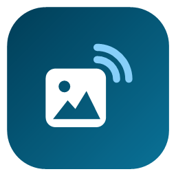

<div align="center">



# Pix Relay — Auto Linux Sync

**Automatically send photos &amp; videos from your Linux PC straight to a Pixel 1–4 over home Wi-Fi — so you can use its free, unlimited Google Photos backup.**

<p>
  
  
  
  
</p>

<br />

<a href="https://github.com/Aussie-App-Studio/Pix-Relay-Auto-Linux-Sync/releases/latest/download/Pix-Relay-Auto-Linux-Sync-x86_64.AppImage">
  
</a>
&nbsp;
<a href="https://github.com/Aussie-App-Studio/Pix-Relay-Auto-Linux-Sync/releases/latest/download/Pix-Relay-Auto-Linux-Sync-amd64.deb">
  
</a>
&nbsp;
<a href="PRIVACY_POLICY.md">
  
</a>

<br />
<br />
<sub>Works on Ubuntu, Linux Mint, Pop!_OS, Fedora, Debian &amp; Arch · No account required · <a href="PRIVACY_POLICY.md"><strong>Privacy Policy (Zero Tracking)</strong></a> · <a href="https://github.com/Aussie-App-Studio/Pix-Relay-Auto-Linux-Sync/releases/latest/download/Pix-Relay-Auto-Linux-Sync-x86_64.rpm">Fedora / RHEL (.rpm)</a> · <a href="https://github.com/Aussie-App-Studio/Pix-Relay-Auto-Linux-Sync/releases/latest">All Releases</a> · <a href="LICENSE">License (All Rights Reserved)</a></sub>

</div>

---

## How to Install &amp; Open on Linux (Takes 30 Seconds)

Pick whichever option matches your Linux PC:

### Option A — Universal AppImage (Works on Every Linux Distro)
1. Click the blue **Download for Linux (AppImage)** button above to download **`Pix-Relay-Auto-Linux-Sync-x86_64.AppImage`**.
2. **Allow it to run:**
   - **No typing:** Right-click the downloaded file → **Properties** → **Permissions** → check **Allow executing file as program** (or *Executable as Program*).
   - **Or 1-line in Terminal:**
     ```bash
     chmod +x ~/Downloads/Pix-Relay-Auto-Linux-Sync-x86_64.AppImage
     ```
3. **Double-click** the file to open Pix Relay!

> [!TIP]
> **On Ubuntu 22.04 / 24.04, if double-clicking the AppImage does nothing:**
> Ubuntu doesn't include AppImage's tiny helper library (`libfuse2`) by default. Either use **Option B (`.deb`)** below, or run this once in Terminal:
> ```bash
> sudo apt update && sudo apt install -y libfuse2
> ```

---

### Option B — Ubuntu, Linux Mint, Pop!_OS &amp; Debian (`.deb` Installer)
1. Click the orange **Ubuntu / Debian (.deb)** button above to download **`Pix-Relay-Auto-Linux-Sync-amd64.deb`**.
2. **Double-click** the `.deb` file to open it in your Software / App Center and click **Install** (or run in Terminal):
   ```bash
   sudo apt install ~/Downloads/Pix-Relay-Auto-Linux-Sync-amd64.deb
   ```
3. Open **Pix Relay Auto Linux Sync** from your app menu!

---

### Option C — Fedora &amp; RHEL (`.rpm` Installer)
1. Download [**`Pix-Relay-Auto-Linux-Sync-x86_64.rpm`**](https://github.com/Aussie-App-Studio/Pix-Relay-Auto-Linux-Sync/releases/latest/download/Pix-Relay-Auto-Linux-Sync-x86_64.rpm).
2. Double-click to install in Software, or run:
   ```bash
   sudo dnf install ~/Downloads/Pix-Relay-Auto-Linux-Sync-x86_64.rpm
   ```

---

## How to Start Syncing Photos to Your Pixel

1. **Open Pix Relay on your Backup Pixel (Pixel 1–4)** in **Receiver** mode (make sure your Linux PC and Pixel are on the same home Wi-Fi).
2. **Pair Once:** Open **Pix Relay Auto Linux Sync**, go to **Pair Pixel**, and click **Pair** (or type the Pixel's Wi-Fi IP / paste its `PIX1:` code).
   - *Using a firewall (`ufw` or `firewalld`)?* If your Pixel doesn't pop up automatically, the **Pair Pixel** screen will show your exact 1-line command to allow local discovery (for example `sudo ufw allow 42889/udp`), or you can just type your Pixel's IP address directly.
3. **Pick What to Sync:** Click **Add Folder** or drag any photo/video folder (or SD card folder) directly into the window.

---

## What It Does (In Plain English)

- **Watches Your Linux Folders Automatically:** Drop in your `Pictures` folder, camera SD card imports, or external drive folders and new photos &amp; videos upload to your Pixel automatically in the background.
- **Safely Free Up Disk Space:** Once your Pixel confirms Google Photos has finished backing up a photo, Pix Relay marks it green (`Cleared by Pixel ✓`) so you can safely send the Linux copy to **System Trash** or an **Archive Drive** in one click.
- **100% Offline &amp; Zero Tracking:** Your photos go straight from your Linux PC to your Pixel over encrypted home Wi-Fi (`ECDH + AES-256-GCM`) — the app never connects to the internet, has no accounts, and collects zero data. Read our [**Privacy Policy**](PRIVACY_POLICY.md).
- **Ultra-Lightweight System Tray Mode:** Closing the window tucks the app neatly into your system tray using minimal memory while keeping folder watching active.

---

## Privacy &amp; License

- **Privacy Policy:** [**Read Privacy Policy (`PRIVACY_POLICY.md`)**](PRIVACY_POLICY.md) — Pix Relay: Auto Linux Sync never connects to the internet and never tracks or collects your data.
- **License:** [**Proprietary — All Rights Reserved (`LICENSE`)**](LICENSE) — Free to download and use personally from official Aussie App Studio releases. Copying, modifying, or redistributing the code, assets, or app is not permitted.

<div align="center">
<sub>© 2026 Aussie App Studio · All Rights Reserved</sub>
</div>
